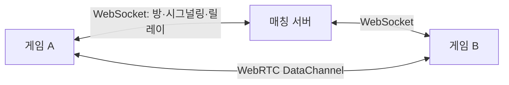

# Digital Tennis Match Server

**6자리 코드로 만나는 온라인 테니스.** 두 플레이어의 방, WebRTC 시그널링, 릴레이 전송과 재접속 상태를 관리하는 Node.js WebSocket 서버입니다.

[빠른 시작](#빠른-시작) · [방 생성 예](#방-생성-예) · [설정·배포](#설정배포) · [기여하기](CONTRIBUTING.md)

## 담당하는 일

- **최대 2인 방:** 혼동하기 쉬운 문자를 제외한 랜덤 방 코드를 만들고 입장·만료·퇴장을 처리합니다.
- **직접 연결 준비:** WebRTC offer·answer·ICE를 상대에게 전달합니다.
- **대체 전송:** 클라이언트가 합의한 연결 세대에서 게임 메시지를 릴레이합니다.
- **접속 복구:** heartbeat, 연결 유예와 일회성 재접속 토큰 교체를 처리합니다.
- **경계 검사:** 현재 소켓의 역할·방·전송 세대와 메시지 크기·형식을 검증합니다.

공 물리·타격·점수와 경기 승패는 **게임 호스트**가 계산합니다. 서버는 BLE 기기에 연결하지 않습니다.

v3 컨트롤러를 사용하는 게스트는 `controllerPrimary`, `motionHorizontalPositive/Negative`, `motionOverheadDown`, `motionShortRotation`, `motionObliqueDown/Up`을 중립 입력으로 보냅니다. 서버는 기존 온라인v1 envelope의 역할·epoch·범위·허용 kind만 검증하고, 게임 호스트가 서브·스매시 등의 의미를 결정합니다. 구형 서버는 이 kind를 거부하므로 새 게임 전에 서버를 갱신해야 합니다. 기존 샷 kind는 유지합니다.

## 빠른 시작

**Node.js 22 이상, npm, Git**이 필요합니다.

```sh
git clone https://github.com/digital-tennis/digital-tennis-match-server.git
cd digital-tennis-match-server
npm ci --ignore-scripts
npm start
```

다른 터미널에서 상태를 확인합니다.

```sh
curl http://127.0.0.1:8080/health
```

정상 응답은 `status: "ok"`이며 방·연결·릴레이 수를 포함합니다. [Digital Tennis 게임](https://github.com/digital-tennis/digital-tennis-game)의 온라인 서버 주소에는 **`ws://127.0.0.1:8080/ws`**를 지정합니다. 첫 게임에서 방을 만들고 두 번째 게임에서 방 코드로 입장합니다.

## 방 생성 예

서버가 켜진 상태에서 저장소 루트의 다른 터미널로 실행합니다. 아래 예는 실제 WebSocket으로 방을 만들고 코드만 출력한 뒤 종료합니다.

```sh
node --input-type=module <<'JS'
import WebSocket from 'ws';
const socket = new WebSocket('ws://127.0.0.1:8080/ws');
const timeout = setTimeout(() => {
  socket.terminate();
  process.exitCode = 1;
}, 5000);
socket.on('open', () => socket.send(JSON.stringify({
  v: 1, type: 'room.create', requestId: 'example-1', payload: {}
})));
socket.on('message', raw => {
  const message = JSON.parse(raw.toString());
  if (message.type === 'room.created') {
    console.log(`Room: ${message.payload.code}`);
    socket.close();
  }
});
socket.on('error', () => { process.exitCode = 1; });
socket.on('close', () => clearTimeout(timeout));
JS
```

이 예는 방 API 확인용입니다. 경기 클라이언트는 두 명의 입장, 시그널링, 전송 합의와 heartbeat를 계속 처리해야 합니다. `room.created`의 재접속 토큰은 로그·URL에 노출하지 않습니다. [전체 온라인 계약](https://github.com/digital-tennis/digital-tennis-docs/blob/main/docs/contracts/online-protocol.md)

## 전송 흐름



직접 DataChannel은 Unity 클라이언트가 생성합니다. 서버의 시그널링 성공만으로 직접 P2P가 성립한 것은 아닙니다. 전송 방식과 epoch를 양쪽이 합의한 후 게임 데이터를 전달합니다. 단절 시 게임을 정지하고, 복구 후 새 epoch와 호스트 스냅샷으로 재개합니다.

## 설정·배포

| 환경 변수 | 기본값 | 용도 |
| --- | --- | --- |
| `HOST` | `127.0.0.1` | 수신 인터페이스. LAN 공개 시 명시적으로 `0.0.0.0` 지정 |
| `PORT` | `8080` | HTTP 상태 확인·WebSocket 포트 |

```sh
HOST=0.0.0.0 PORT=8080 npm start
```

`.env.example`은 참고용이며 `npm start`가 `.env` 파일을 자동으로 읽지는 않습니다. 같은 PC의 주소와 다른 PC에서 접근 가능한 주소를 구분하세요. 인터넷에는 TLS 프록시를 두고 `wss://실제도메인/ws`를 사용합니다. [Docker Compose·Caddy 배포 안내](docs/deployment.md)를 제공합니다.

방은 메모리에 저장되어 서버 재시작 시 사라집니다. 계정·랭킹·호스트 이전·수평 확장은 현재 범위에 포함되지 않습니다. 같은 Mac 두 게임의 온라인 검증과 서로 다른 PC/WAN 검증은 별도이며, 물리 Windows·WAN 검수는 남아 있습니다.

## 개발·검사

```sh
npm run check
npm test
node tools/load-check.mjs 8 5
```

단위 검사와 실제 WebSocket 연결로 방 격리·역할·전송 합의·재접속·오류 입력을 확인합니다. 부하 검사는 합성 클라이언트를 사용합니다. 실제 랠리·득점·화면 동기화 검증은 [게임 통합 기록](https://github.com/digital-tennis/digital-tennis-game/blob/main/docs/software-integration.md)을 참고하세요.

| 경로 | 내용 |
| --- | --- |
| `src/server.js` | HTTP·WebSocket·연결 수명 |
| `src/rooms.js` | 방·역할·시그널링·재접속 |
| `src/protocol.js` | 메시지 검증 |
| `tests/`, `tools/` | 단위·실소켓·부하 검사 |
| `deploy/`, `docs/` | 컨테이너 구성과 운영 안내 |

## 도움말·기여

[Digital Tennis](https://github.com/digital-tennis)가 관리합니다. [Issues](https://github.com/digital-tennis/digital-tennis-match-server/issues)에 Node 버전·실행 환경·재현 순서와 오류 코드를 남겨 주세요. 재접속 토큰은 제외합니다. 변경은 [기여 안내](CONTRIBUTING.md)를 따릅니다.

## 라이선스

직접 작성한 코드·문서는 [Apache-2.0](LICENSE)입니다. [NOTICE](NOTICE)와 의존성의 [외부 코드 고지](THIRD_PARTY_NOTICES.md)를 함께 확인하세요.
